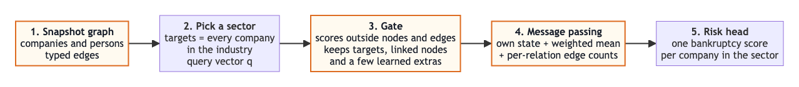
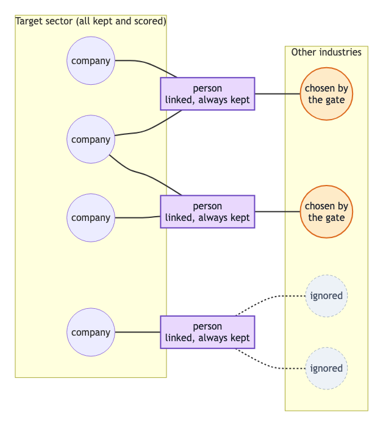
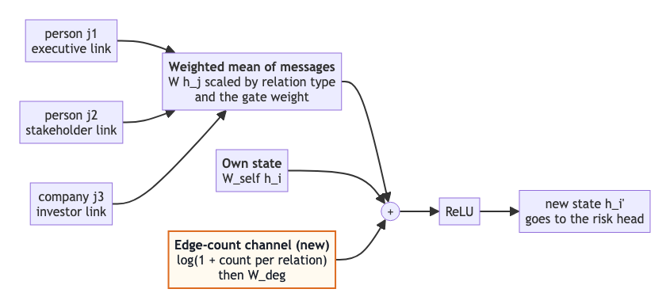
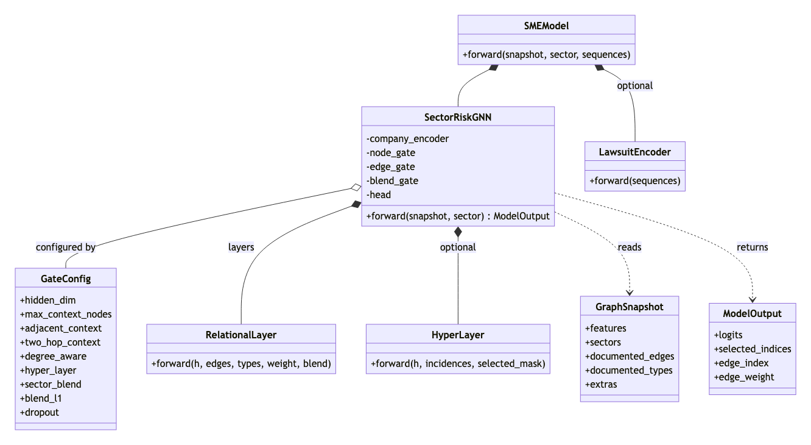
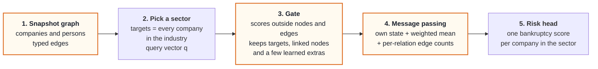
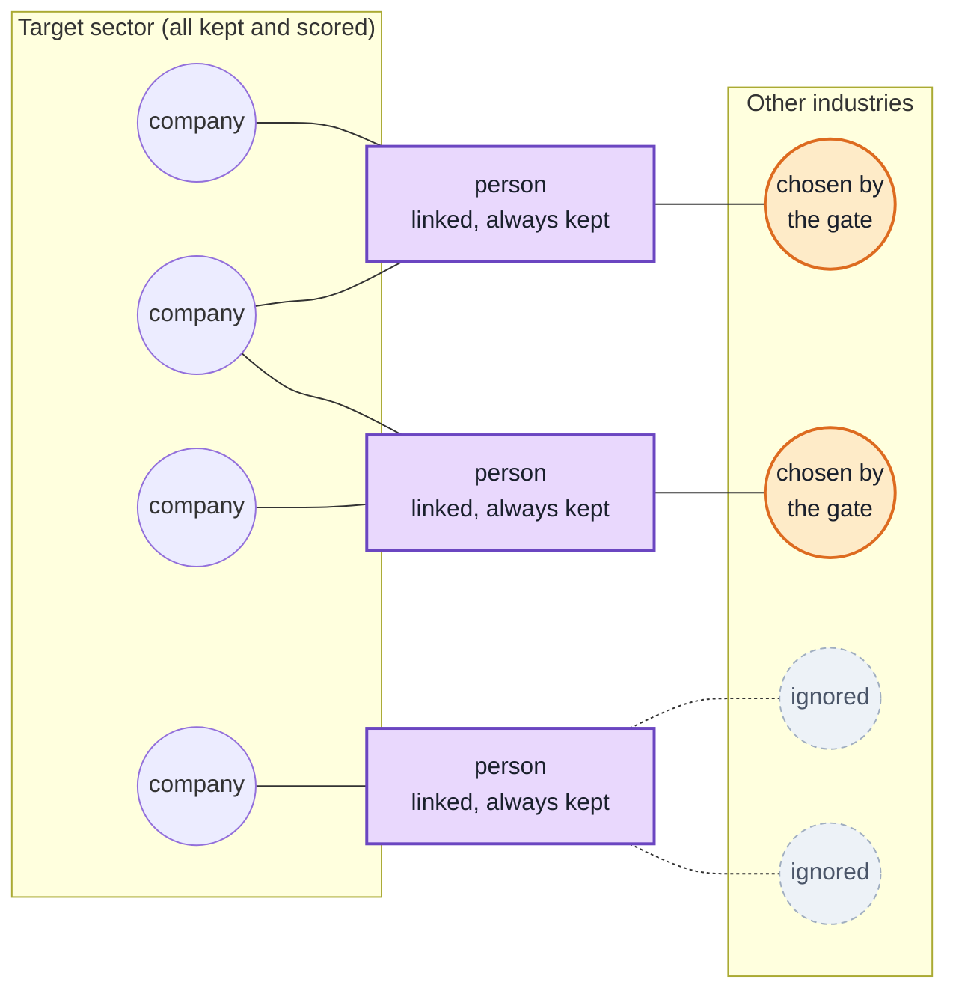
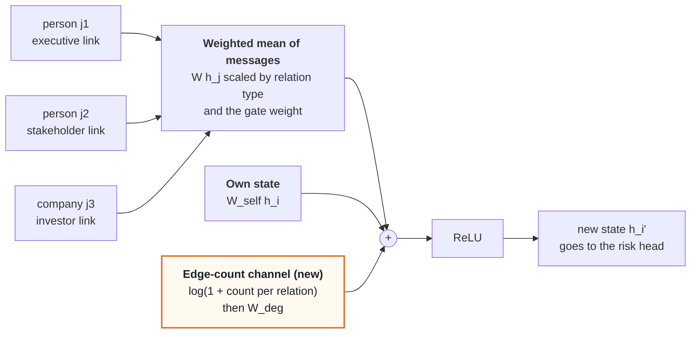
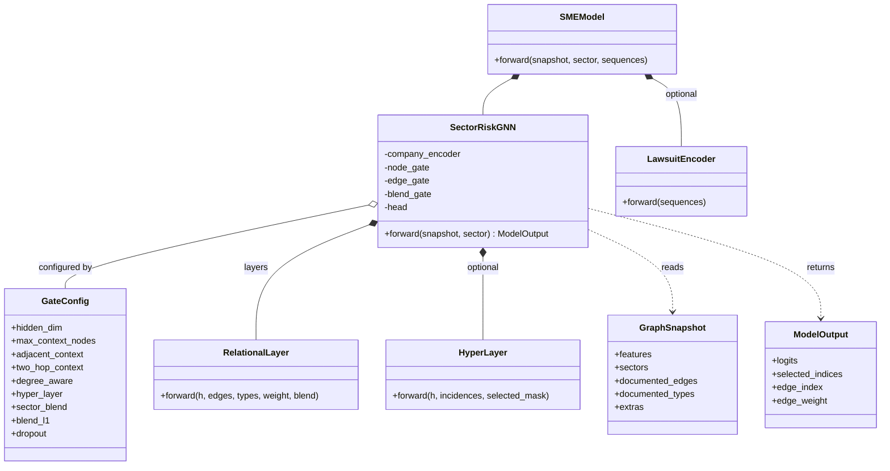

# Risk Assesment

A **sector-gated graph neural network** for company bankruptcy risk: pick an industry, keep every company in it, let a learned gate choose which outside companies, people and links matter, then score each company in the sector.

The model is evaluated on **SMEsD**, a public Chinese-SME bankruptcy dataset with a company-person graph (Wei et al., *Information Sciences* 2024).

## Dataset: SMEsD

A public Chinese small-and-medium-enterprise bankruptcy dataset with a company-person graph.

- **Companies and labels.** 4,028 companies, each labelled bankrupt (1) or surviving (0). Official time split: train 2,816 (57.6% bankrupt), valid 721 (49.1%), test 491 (64.8%).
- **Company inputs.** Registered capital, paid-in capital and set-up age in months, plus lawsuit records for roughly 42-45% of companies (cause type, court type, result, timing).
- **Graph.** Companies and persons are nodes, with 20 relation types. Company-person links dominate (supervisor, executive, stakeholder, investor); direct company-company links (invest, branch, loan, deal, rent, creditor) are sparse.
- **Sectors.** Industry groups (108, the largest with 634 companies) define the sectors the model scores, alongside area (153) and qualification (756) groups.
- **Time.** Features are measured from each company's observation time (tied to the bankruptcy date for bankrupt firms, December 2021 for survivors).

Details and data checks: [`docs/DATASET_NOTES.md`](docs/DATASET_NOTES.md).

## Architecture

### 1. Pipeline



### 2. What the gate keeps for one sector



### 3. One message-passing update



### 4. Code structure (UML class diagram)



In words:
1. **Graph.** Companies *and persons* are nodes. Typed edges: supervisor, executive, stakeholder, investor, and company-company links.
2. **Pick a sector** (an industry). Targets are every company in it; a query vector summarizes the sector.
3. **Gate.** Scores every outside node and edge given the query. Keeps all targets, every outside node linked to a target, and a few learned extras. Per node it keeps the top-k edges; the gate scores become message weights, so the gate is trained through the loss (the selection itself is a hard top-k).
4. **Message passing.** Typed messages along the kept edges: own state + weighted mean of neighbour messages + an explicit **per-relation edge-count channel**.
5. **Risk head.** One bankruptcy score per company in the sector.

Optional pieces (all off by default, in `risk_gnn/model.py`): `adjacent_context`, `two_hop_context`, `degree_aware`, `context_per_target`, `hyper_layer`, `sector_blend` (a person's risk summary is a learned, sector-conditioned blend of its in-sector and out-of-sector companies, with an L1 penalty on the out-of-sector weight), `dropout`, and the options `numeric_embedding` (quantile-bin encoding of inputs), `multi_aggregate` (max and degree-amplified mean next to the mean), `degree_mlp` and `jumping_knowledge`.

<details>
<summary>Mermaid source of the four diagrams (editable; GitHub renders these natively)</summary>

**Pipeline**



**Gate**



**Message passing**



**UML classes**



</details>

## Results (SMEsD official split: train 2,816 / valid 721 / test 491 companies)

| Model | Test AUC (95% CI) | Test AP | Valid AUC |
|---|---|---:|---:|
| **Sector-gated GNN (final run)** | **0.817 (0.778, 0.853)** | 0.890 | 0.876 |

Final model: rank average of three variants of the architecture (aggregation block, quantile numeric embedding, pairwise ranking loss, lawsuit vectors, sector blend), chosen on validation AUC, 10 seeds each. The interval is a 95% bootstrap over the 491 test companies. Test prevalence is 64.8% bankrupt, so AUC is the headline (a random ranking already has AP 0.648).

**What it beats** (published SMEsD results, as reported in Wei et al. 2024; their split is slightly different, so this is a reference comparison, not a paired test):

| Published system | Test AUC | Our model |
|---|---:|---|
| GBDT | 0.684 | +0.133 |
| GCN | 0.710 | +0.107 |
| Best GNN baseline | 0.756 | +0.061 |

Per-variant numbers and paired contrasts for this run are in [`results/summary/`](results/summary/).

## Run it

```bash
pip install -r requirements.txt
bash scripts/fetch_data.sh          # clones the SMEsD data (ComRisk repo) into ./ComRisk; not redistributed here
python -m pytest -q                 # unit tests, no data needed
python -m benchmark.run4 --variant TEAR --tag r4_TEAR --seeds 10   # one variant (T0 T2 TP TL TE TA TR TEAR TLEAR)
python -m benchmark.report4         # headline picked on validation, paired contrasts
```

CPU only. `kaggle/smesd_round4_kaggle.ipynb` runs all variants on Kaggle; it needs a private dataset containing this code plus `ComRisk/` (build it with `bash scripts/make_kaggle_zip.sh`).

## Layout

```
risk_gnn/     model (gate, typed message passing, optional layers), snapshot schema, loss
benchmark/    SMEsD loader (data.py), model extensions, final-run script (run4.py), report (report4.py)
tests/        unit tests
docs/         diagrams/ (Mermaid source), images/ (PNG renders), DATASET_NOTES.md
results/summary/   final-run tables
kaggle/       notebook for the final run
scripts/      fetch_data.sh, make_kaggle_zip.sh
```

## Data and licensing

SMEsD comes from <https://github.com/shaopengw/ComRisk>, which has **no license file**; the data is not included here. Please cite: Wei, Lv, Guo, Yang, Chen, Zhao, Li, Zhuang, Kou, "Combining Intra-Risk and Contagion Risk for Enterprise Bankruptcy Prediction Using Graph Neural Networks", *Information Sciences*, 2024. This repository has no license yet.
